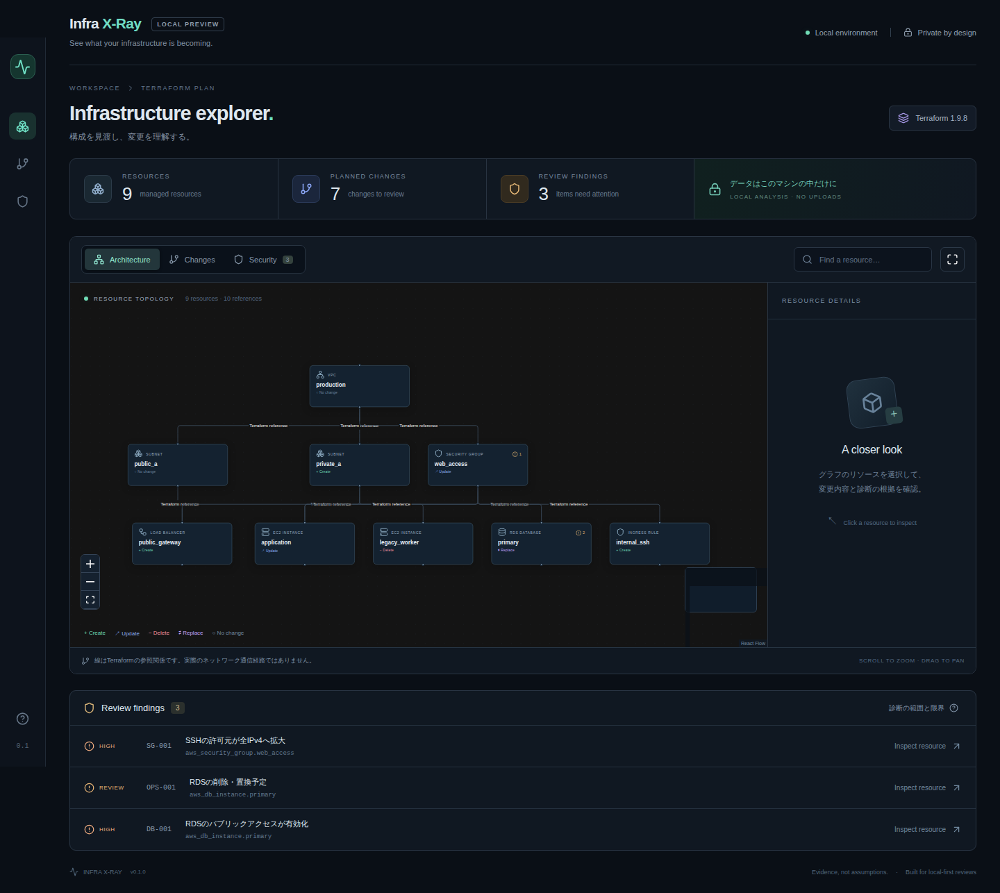

# Infra X-Ray

**See what your infrastructure is becoming.**

[](https://github.com/yotatameguchi-boop/infra-xray/actions/workflows/test.yml)

Terraform 1.x の plan JSON をローカルで解析し、構成・変更・確認すべきセキュリティ設定を可視化する OSS の v0.1 実装です。AWSへの接続やインフラの変更は行いません。

## スクリーンショット



スクリーンショットは同梱の人工planを使い、Playwrightで実際の画面から生成しています。

## ビルド済みパッケージで起動

[GitHub Releases](https://github.com/yotatameguchi-boop/infra-xray/releases)から `infra-xray-0.1.0.zip` をダウンロード・展開してください。wheel単体とソース配布物、SHA256SUMSも公開しています。

同梱のwheelを使う場合はPython 3.9以上だけで起動できます。Node.jsや外部パッケージの取得は不要です。

```bash
cd infra-xray
python3 -m venv .venv
source .venv/bin/activate
python -m pip install --no-index dist/infra_xray-0.1.0-py3-none-any.whl
infra-xray view examples/synthetic-plans/review.json
```

## ソースからのクイックスタート

Python 3.9以上、Node.js 20.19以上と npm が必要です。依存パッケージの初回インストール時のみインターネット接続が必要です。解析・表示はローカルで完結します。

```bash
cd infra-xray
python3 -m venv .venv
source .venv/bin/activate
# Windows: .venv\Scripts\activate
cd web
npm ci
npm run build
cd ..
python -m pip install -e .
infra-xray view examples/synthetic-plans/review.json
```

ブラウザーが開きます。表示されない場合はCLIが出力するURLを開いてください。URLの `#token` は、この起動中の解析結果を読み出すためのトークンです。停止は `Ctrl+C`。空きポートを自動選択し、`127.0.0.1` のみにバインドします。

この配布ディレクトリにはビルド済みUIも含むため、ソースから次のコマンドで直接実行できます（Python側は標準ライブラリのみ）。

```bash
python3 -m infra_xray view examples/synthetic-plans/review.json
```

## 実際のTerraform planを表示

```bash
terraform plan -out=tfplan
terraform show -json tfplan > plan.json
infra-xray view plan.json
```

Terraform CLIの実行はユーザー側で行います。Infra X-RayはTerraformを起動せず、JSONを読み取り専用で処理します。入力JSONには秘密情報が含まれる場合があります。リポジトリにコミットしないでください。

```bash
infra-xray view plan.json --no-open --port 8765
infra-xray check plan.json  # 許可リストに基づく解析済みJSONを標準出力
```

不正なJSON、state JSON、未対応のformat_versionメジャー（1以外）、Terraform 1.x以外、未対応の変更操作は終了コード2で拒否します。入力サイズ上限は50 MiBです。入力内容を含む例外やアクセスログは出力しません。

## 画面の使い方

- **Architecture**：確認できたリソースの参照関係を表示。
- **Changes**：Create / Update / Delete / Replace / No change を色・記号で区別。
- **Security**：SG-001 / DB-001 / OPS-001の確認事項があるリソースを強調。
- ノードをクリック、またはTabでフォーカスしてEnterで選択すると、右パネルに許可された属性の変更前後・診断根拠・参照関係を表示。
- マウスホイールでズーム、背景のドラッグでパン、右上の全体表示ボタンで再配置したグラフ全体に戻る。
- 検索はTerraformアドレスとリソース種別で絞り込み。診断一覧からリソースを選択可能。
- 「診断の範囲と限界」を開くと対象外条件を表示。

入力はCLIで指定します。別のplanを開く場合は新しいCLIを起動してください。ブラウザーからのJSONアップロード機能はありません。

## 対応リソースとルール

対象：`aws_instance`、`aws_security_group`、`aws_vpc_security_group_ingress_rule`、`aws_db_instance`、`aws_vpc`、`aws_subnet`、`aws_lb`。

- **SG-001**：全IPv4（0.0.0.0/0）へのTCP/22許可が、存在しない状態から存在する状態へ変わる場合。inline ingressと独立したingress ruleに対応。TCPの範囲指定、プロトコル6、全プロトコル-1も処理。
- **DB-001**：RDSのpublicly_accessibleがfalseからtrueになる場合、またはtrueで新規作成する場合。
- **OPS-001**：RDSの削除・置換。置換の両方のaction順序に対応。

不明・機密・欠落属性が原因で判定できないときは警告を断定せず、詳細パネルに制限事項を表示します。既に公開されていた設定は新たな拡大として検出しません。全プロトコルを許可する別ルールの存在も確認します。IPv6はSG-001の対象外です。独立したルール同士の統合評価はしません。

## サンプルとテスト

ローカル検証ではPython 55件・Vitest 6件とビルドが通過しました。実ブラウザーE2Eはこの環境のmacOSサンドボックス制限により起動できていません。詳しくは[検証記録](docs/validation.md)を参照してください。

```bash
python -m pip install pytest
python -m pytest -q
cd web
npm test
npm run build
npx playwright test
```

E2Eでは、親ディレクトリでPython CLIを自動起動し、ビルド済みUIを検証します。Playwright用Chromiumは `npx playwright install chromium` でインストールできます。

- `examples/synthetic-plans/review.json`：7種類・9リソース・3件の診断。
- `examples/synthetic-plans/safe.json`：診断ルールに該当しないケース。
- `examples/synthetic-plans/100-resources.json`：100ノード表示の性能確認用。
- 全サンプルは人工データです。テスト用の機密情報カナリアも架空の文字列です。

## 実装構成

- `infra_xray/parser.py`：形式検証・リソース抽出。
- `infra_xray/sanitizer.py`：リソース別許可リスト、sensitive / unknown処理。
- `infra_xray/graph.py`：確定できるconfiguration参照だけを抽出。
- `infra_xray/rules.py`：三値（真・偽・不明）に基づく診断。
- `infra_xray/cli.py`：CLI・トークン保護したローカルHTTPサーバー。
- `web/src`：React / TypeScript / React Flow / DagreによるUI。
- `infra_xray/static`：同一オリジン配信するビルド済みUI。

Python側は依存を減らすため標準ライブラリで検証しています。Pydantic / NetworkXは採用候補でしたがv0.1では必須ではありません。解析と表示の間にはバージョン付きJSON境界を設けています。

## 制限事項

セキュリティ監査や実際のネットワーク到達性検査ではありません。線はTerraformの参照関係であり、通信経路ではありません。IAM・NACL・ルートテーブル・バックアップ・IPv6は評価しません。

`count` / `for_each` の曖昧なインスタンス展開、module出力・変数経由の関係、`depends_on` は推測せず省略します。正確なアドレスに直接解決できる参照のみ対応します。対応外リソースは描画しません。大規模構成の折りたたみは未実装です。Windows / Linuxでの実機検証は今後の対象です。

sensitiveフラグを尊重し、password・user_data・tags・outputs・variables等を除外します。Terraformアドレスと許可リスト属性は表示対象なので、これらに機密情報を埋め込まないでください。許可リストは任意の値の機密性を自動判別する仕組みではありません。

[設計](docs/architecture.md) · [セキュリティ](docs/security.md) · [元の要件](docs/requirements.md) · [検証結果](docs/validation.md)

[MIT License](LICENSE) · [脆弱性の報告](SECURITY.md) · [開発に参加する](CONTRIBUTING.md) · [変更履歴](CHANGELOG.md) · [GitHub Actions](https://github.com/yotatameguchi-boop/infra-xray/actions)
